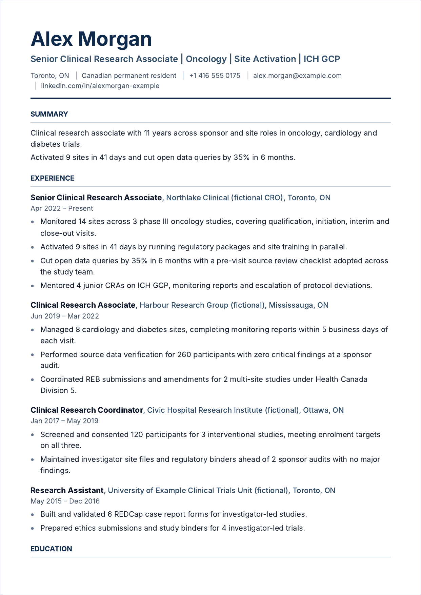

<div align="center">

<picture>
  <source media="(prefers-color-scheme: dark)" srcset="docs/brand/logo-dark.svg">
  
</picture>

<br>

**Your AI assistant for CVs that are honest, readable by hiring software, and built on real hiring research.**

[](https://github.com/naufal-nazar/nomagic-cv/actions/workflows/ci.yml)
[](https://github.com/naufal-nazar/nomagic-cv/stargazers)
[](LICENSE)
[](#works-with)

[Get started](#get-started) · [Commands](#commands) · [What you get](#what-you-get) · [Your data](#your-data-stays-yours)

</div>

---

Most AI CV tools promise magic: instant scores, keyword tricks, one-click perfection. They also invent things you never did.

**NoMagicCV works the other way.** It interviews you once, keeps your real experience in one place, and builds every CV from that. If a number, job title or skill isn't something you confirmed, it doesn't go in. Every tip it follows comes from published hiring research, and it tells you how strong that research is.

## What you get

<table>
<tr>
<th width="50%">Classic: for job portals</th>
<th width="50%">Modern: for emailing a hiring manager</th>
</tr>
<tr>
<td></td>
<td></td>
</tr>
</table>

<sub>Example for a fictional candidate. Both versions come from the same checked content.</sub>

- **A master CV for each kind of role you want**, tailored to each job in minutes.
- **A matching cover letter and answers to application questions**, consistent with your CV.
- **Checks before anything goes out:** no invented facts, nothing hiring software can't read, no mismatched dates.
- **Protection from booby-trapped job ads** that hide instructions for AI tools.
- **Optional emails to employers**, as drafts you approve or sent automatically within limits you set.
- **A tracker** that reminds you to follow up and tells you honestly which CV version is working.

## Get started

**The easy way: let your AI assistant set it up.** Open Claude Code or Codex and paste:

```text
Install NoMagicCV from https://github.com/naufal-nazar/nomagic-cv by following its INSTALL.md, then run nomagic-facts.
```

**Or set it up yourself** with [uv](https://docs.astral.sh/uv/getting-started/installation/) (or plain [Python 3.10+](https://www.python.org/downloads/): use `python3` instead of `uv run`):

```bash
git clone https://github.com/naufal-nazar/nomagic-cv.git
cd nomagic-cv
uv run scripts/setup.py
```

Then open the folder in your assistant and type `/nomagic-facts` (in Codex, say "run nomagic-facts"). Full guide: [`INSTALL.md`](INSTALL.md).

## Commands

Type these in your AI assistant. They're listed in the order you'd normally use them.

| Command | What it does |
|---|---|
| `/nomagic-facts` | Asks for your current CV (if you have one) and interviews you about your experience. Saves it all as your fact sheet, which only you can change. |
| `/nomagic-master` | Writes a master CV for each kind of role you're targeting, checks it, and saves it as version 1, 2, 3… |
| `/nomagic-tailor` | Paste a job ad. Get a CV, cover letter and application answers tailored to it, plus an honest list of requirements you don't meet. **You** submit; it never does. |
| `/nomagic-check` | Checks any CV or application and explains what to fix, and why. |
| `/nomagic-employers` | Finds organisations in your field and area to contact (optional). |
| `/nomagic-outreach` | Writes short, honest emails to employers: drafts for you to send, or sent automatically within your daily limit. |
| `/nomagic-inbox` | Reads replies from employers, records them, and drafts thank-yous. |
| `/nomagic-track` | Shows your applications and which follow-ups are due. |
| `/nomagic-stats` | Shows which CV version gets more callbacks, and says "not enough data yet" when that's the honest answer. |
| `/nomagic-daily` | A morning routine that runs on its own: checks replies, prepares follow-ups, sends you a short report. |

## Your data stays yours

- Everything stays in a private folder on your computer. Nothing is uploaded by NoMagicCV.
- Your original CV is kept untouched. Every new version is saved separately, so nothing is ever lost.
- It never submits an application, and never emails anyone unless you turn that on.
- It never changes your fact sheet without asking you.

## Why you can trust it

- **No invented facts.** Every line in your CV is checked against what you confirmed. This is done by code, not by asking the AI to behave.
- **Research, not folklore.** For example: a well-written CV leads to more hires, a tailored cover letter gets more callbacks than a generic one, and most applications arrive in the first four days, so it helps you apply early. Popular myths, like "75% of CVs are rejected by robots" or "your CV must fit on one page", are explained and set aside. [See the evidence](skills/nomagic-cv/references/evidence.md).
- **A second opinion.** A separate reviewer checks each CV without having seen it written, because AI tools tend to rate their own writing too highly.

## Works with

| | |
|---|---|
| **Claude Code** (terminal, desktop app, IDE) | Everything, including the commands above and the automatic checks. |
| **Codex** (CLI, IDE, app) | Everything; say "run nomagic-tailor" instead of typing a slash command. |
| **Other AI coding assistants** | Point them at `AGENTS.md`; the checks work the same. |
| **Claude app** (chat) | The CV method and checks, uploaded as a skill. |
| **Email** | Gmail and Microsoft 365 through Claude's connectors or their official servers. |

## For developers

How the checks, hooks and evidence system work, agent support details and how NoMagicCV compares to other tools: [`docs/DEVELOPERS.md`](docs/DEVELOPERS.md). Contributions welcome: [`CONTRIBUTING.md`](CONTRIBUTING.md).

Built on and inspired by open-source projects including [RenderCV](https://github.com/rendercv/rendercv), [JSON Resume](https://github.com/jsonresume/resume-schema), [Reactive Resume](https://github.com/amruthpillai/reactive-resume), [ai-job-search](https://github.com/ai-job-search-dev/ai-job-search), [career-ops](https://github.com/santifer/career-ops), [google-maps-scraper](https://github.com/gosom/google-maps-scraper) and [google-maps-scraper-kit](https://github.com/Mahanaicoach/google-maps-scraper-kit). Full list: [`CREDITS.md`](CREDITS.md).

## License

Code under [MIT](LICENSE), framework text under [CC BY 4.0](LICENSE-CONTENT). [Cite this project](CITATION.cff) · [Security](SECURITY.md) · Not legal or career advice.

<div align="center">
<br>

<br>
<sub>Made by <a href="https://github.com/naufal-nazar">Noufal Nazar</a>. If NoMagicCV helps you, a ⭐ helps others find it.</sub>
</div>
