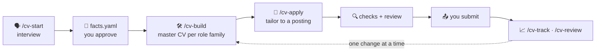

<div align="center">

# 🪄🚫 NoMagicCV

### No magic. No myths. Just evidence.

**An open-source AI resume & CV builder agent where every fact is checked by code<br>and every rule is backed by a named study.**

[](https://github.com/naufal-nazar/nomagic-cv/actions/workflows/ci.yml)
[](LICENSE)
[](LICENSE-CONTENT)
[](requirements.txt)
<br>
[](https://agentskills.io)
[](#-claude-code)
[](#-codex)
[](#-privacy)

[🚀 Quick start](#-quick-start) · [🧭 How to use](#-how-to-use) · [🤖 For AI agents](#-for-ai-agents) · [📚 Evidence](#-the-evidence) · [🤝 Contribute](#-contributing)

</div>

---

Most AI CV tools promise magic: instant ATS scores, *"75% of CVs are rejected by robots"*, one-click perfection.
**NoMagicCV does the opposite.** It brings the best open-source CV tools under one roof, checks every fact against your own records with code, and follows only rules backed by graded research.

> [!TIP]
> **The only magic is the receipts.** Every line in your CV points back to a fact you approved. Change a number, rename a title or invent a skill, and the check fails before anything is sent.

## ✨ Why NoMagicCV

<table>
<tr>
<td width="50%" valign="top">

### 🧾 Facts checked by code
Every title, date, number, tool and credential traces to your `facts.yaml`. Invented facts fail the build.<br>
<sub>`scripts/fact_check.py` · runs automatically via hook</sub>

</td>
<td width="50%" valign="top">

### 📚 Rules with receipts
Every rule has an id, a grade (A/B/C) and a named study. No study, no hard rule, enforced in CI.<br>
<sub>`rules/rules.yaml` · `scripts/rules_lint.py`</sub>

</td>
</tr>
<tr>
<td valign="top">

### 🔍 Independent review
A reviewer that never saw the drafting, ideally on a different model family, because LLMs prefer CVs they wrote themselves ([Xu et al., AIES 2025](https://doi.org/10.1609/aies.v8i3.36755)).<br>
<sub>`reviewer` subagent · `scripts/cross_review.sh`</sub>

</td>
<td valign="top">

### 🧩 One version of the truth
CV, cover letter, LinkedIn and screening answers state the same years, dates and contacts.<br>
<sub>`scripts/consistency_check.py`</sub>

</td>
</tr>
<tr>
<td valign="top">

### 🤖 See what the ATS sees
Extracts text from your PDF/DOCX and flags missing headings, contact details in headers, columns, tables, and lines lost or reordered.<br>
<sub>`scripts/parse_check.py`</sub>

</td>
<td valign="top">

### 📈 Honest statistics
Callback rates per CV version with 95% intervals. It won't crown a winner from 20 applications.<br>
<sub>`scripts/tracker.py stats`</sub>

</td>
</tr>
<tr>
<td valign="top">

### 🧪 Public benchmark
Fabrication rate and must-have coverage across AI models, on fictional candidates.<br>
<sub>`evals/`</sub>

</td>
<td valign="top">

### 🔒 Private by default
Your data lives in `workspace/` (gitignored), and a pre-commit hook blocks it from ever being pushed.<br>
<sub>`scripts/git-hooks/pre-commit`</sub>

</td>
</tr>
</table>

## 🚀 Quick start

```bash
git clone https://github.com/naufal-nazar/nomagic-cv.git
cd nomagic-cv
make setup          # installs deps, privacy hook and workspace folders
```

Then open your agent in the folder:

| Agent | Start with |
|---|---|
|  | `claude` then type `/cv-start` |
|  | `codex` then say `run cv-start` |
|  | open the folder and say `Read AGENTS.md, then run cv-start` |

<sub>Needs Python 3.10+. Optional: [RenderCV](https://github.com/rendercv/rendercv) for PDFs (`pip install "rendercv[full]"`) and `pdftotext` (poppler) for the parse test.</sub>

## 🧭 How to use

You run six commands. A **Guide** hands each step to a specialist and nothing goes out without your approval.



| Step | Command | What happens | You get |
|:--:|---|---|---|
| 1️⃣ | `/cv-start` | 🧑‍💼 The **Career Consultant** interviews you, one question at a time | `workspace/facts.yaml`, your single source of truth |
| 2️⃣ | `/cv-build` | 🛠️ The **Resume Builder** writes a master CV per role family; 🔍 the **Reviewer** checks it | `workspace/cvs/masters/<family>.md` |
| 3️⃣ | `/cv-apply <posting>` | 🔎 **Researcher** decodes the posting → 🛠️ Builder tailors → 🔍 Reviewer → 📒 **Tracker** logs it | Tailored CV, cover letter, screening answers, tracker row |
| 4️⃣ | `/cv-check <file>` | Every check on a CV, folder or PDF, with rule ids and grades | A ranked list of fixes |
| 5️⃣ | `/cv-track` | Status updates and follow-ups due | `workspace/tracker.csv` |
| 6️⃣ | `/cv-review` | Callback rates with uncertainty, and one change to test next | An honest read of what's working |

<details>
<summary><b>🧾 What a CV with receipts looks like</b></summary>

<br>

CVs are Markdown with provenance tags. The tags are stripped when you export.

```markdown
### Data Analyst, Acme Retail, Toronto, ON | Mar 2021 - Present <!-- role:acme -->
- Built weekly demand forecasts for ~40 stores in SQL and Python. <!-- f:acme.r1 -->
```

Change "40" to "60" or rename the title to "Senior Data Analyst", and the check fails:

```diff
- ERROR  cv.md:10  [R-HONEST-02] Role line must start with the official title and employer exactly: 'Data Analyst, Acme Retail'.
- ERROR  cv.md:13  [R-HONEST-01] Number '60' is not in the cited fact(s) ['acme.r1'].
```

Export when it passes:

```bash
python scripts/export.py rendercv cv.md -o My_CV.yaml && rendercv render My_CV.yaml   # PDF
python scripts/export.py jsonresume cv.md -o resume.json                              # JSON Resume / Reactive Resume
```

</details>

<details>
<summary><b>🪝 What the hooks do automatically</b></summary>

<br>

| Hook | When | What it does |
|---|---|---|
| 🟢 SessionStart | session opens | Shows follow-ups due and your next step |
| 🛑 PreToolUse | before `facts.yaml` changes | Asks you first: only you change the truth |
| 🧾 PostToolUse | after a CV, letter or answers file is written | Runs fact and consistency checks; errors go back to the agent to fix |
| 🤖 PostToolUse | after a PDF/DOCX export | Runs the parse test against the source |
| 📒 Stop | before the agent finishes | Blocks while an application folder is untracked |

Hooks only trigger. The plain Python scripts do the checking, so every agent gets the same checks.

</details>

<details>
<summary><b>🛠️ No agent? Run the checks yourself</b></summary>

<br>

```bash
python scripts/fact_check.py workspace/cvs/masters/backend.md
python scripts/consistency_check.py workspace/applications/2026-11-19-acme-backend
python scripts/parse_check.py cv.pdf --source cv.md
python scripts/tracker.py add --company Acme --role "Backend Engineer" --family backend --cv-version be-v1
python scripts/tracker.py stats
```

</details>

## 🤖 For AI agents

> [!NOTE]
> **Any coding agent can use NoMagicCV.** The skill follows the open [Agent Skills](https://agentskills.io) format, the rules live in [`AGENTS.md`](AGENTS.md), and every check is a plain Python script any agent can run. Claude Code and Codex get the most automation; other agents run the same checks as steps.

### Compatibility

| Feature | Claude Code | Codex | Gemini CLI, Cursor, Copilot, others |
|---|:--:|:--:|:--:|
| 📘 Skill (`SKILL.md`) | ✅ `.claude/skills/` | ✅ `.agents/skills/` | ✅ where the agent supports Agent Skills |
| 📜 Golden rules (`AGENTS.md`) | ✅ via `CLAUDE.md` | ✅ native | ✅ point the agent at it |
| ⌨️ Commands | ✅ `/cv-*` slash commands | 💬 say "run cv-apply" | 💬 say "run cv-apply" |
| 👥 Subagents | ✅ 5 built in | 🔁 run as steps | 🔁 run as steps |
| 🪝 Automatic hooks | ✅ ready | ⚠️ [example config](adapters/codex/README.md), verify for your version | ❌ run the scripts as steps |
| 🧾 Fact, parse, consistency checks | ✅ | ✅ | ✅ |

<sub>Tested end to end: the scripts, hooks dispatcher and evals. Agent support beyond Claude Code and Codex follows each agent's published Agent Skills support; please open an issue with results from your agent.</sub>

### 📋 Copy-paste prompt for any agent

```text
You are working in the NoMagicCV repository.
1. Read AGENTS.md and skills/nomagic-cv/SKILL.md before doing anything.
2. Every fact must come from workspace/facts.yaml. Ask me for missing facts; never invent.
3. Only I change workspace/facts.yaml. Ask before writing to it.
4. After writing any CV, letter or answers file, run the checks in AGENTS.md and fix errors by asking me, never by weakening a check.
5. Never submit an application. I send everything myself.
Start with: cv-start.
```

### 🗺️ Map for agents

```text
AGENTS.md                      golden rules + command map (read first)
skills/nomagic-cv/SKILL.md     the method, workflow and CV source format
rules/rules.yaml               rules with ids, grades and strength
rules/sources.yaml             studies behind the rules
.claude/commands/cv-*.md       step-by-step procedure for each command
.claude/agents/*.md            role definitions (consultant, researcher, builder, reviewer, tracker)
scripts/*.py                   deterministic checks; exit code 1 = problems found
hooks/dispatch.py              hook entry point for Claude Code and Codex
workspace/                     the candidate's private data (gitignored)
```

###  Claude Code

Everything loads from `.claude/`: slash commands, subagents and hooks. Open the folder with `claude` and type `/cv-start`.

###  Codex

Codex reads `AGENTS.md` and the skill natively. Say the command name ("run cv-apply on this posting: …"). To turn on automatic checks, follow [`adapters/codex`](adapters/codex/README.md).

## 📚 The evidence

| | Finding | Source | Grade |
|:--:|---|---|:--:|
| ✍️ | Better-written CVs get ~8% more hires | Wiles, Munyikwa & Horton (NBER; Management Science 2025) | 🟢 A field |
| 🔤 | Spelling errors hurt as much as missing experience | Lacroux & Martin-Lacroux (2016) | 🟢 A lab |
| 💬 | Plain words read as more intelligent | Oppenheimer (2006) | 🟢 A lab |
| 🤝 | Referrals raise hiring odds | Burks et al. (QJE 2015) | 🟢 A field |
| ⏳ | Longer unemployment lowers callbacks | Kroft, Lange & Notowidigdo (QJE 2013) | 🟢 A field |
| 🍁 | Local experience nearly doubles immigrant callbacks (5.9% → 11%) | Oreopoulos (AEJ: Policy 2011) | 🟢 A field |
| ⚖️ | Identity cues and AI rankers affect callbacks | Kang et al. (ASQ 2016); Wilson & Caliskan (AIES 2024) | 🟢 A |
| 🤖 | AI screeners prefer AI-written CVs (68–92%) | Xu, Li & Jiang (AIES 2025) | 🟢 A lab |
| ✉️ | Tailored cover letters: 16.4% vs 10.7% callbacks | ResumeGo | 🔵 B |
| 📄 | Two pages preferred for experienced candidates | ResumeGo | 🔵 B |
| ⚡ | 56% of applications arrive in the first 96 hours | St. Louis Fed | 🔵 B |
| 👀 | The first scan is short (~7 s) | Ladders eye-tracking | 🟠 C |

<sub>🟢 A = peer-reviewed experiment or field study · 🔵 B = large controlled experiment, not peer-reviewed · 🟠 C = survey or vendor analysis (direction, not proof).<br>
Full table, myths and links: [`evidence.md`](skills/nomagic-cv/references/evidence.md) · [`myths.md`](skills/nomagic-cv/references/myths.md) · [`sources.yaml`](rules/sources.yaml)</sub>

> [!IMPORTANT]
> The famous **"7-second scan"** comes from one vendor study (grade C). NoMagicCV designs the top third for a fast scan and tells you how strong the evidence is. Grade C rules are marked `test`: worth trying, never mandatory.

## 🧠 Design decisions

- 🙋 **You run it** and approve every line. The agent never submits.
- ✏️ **Editor mode by default** (you draft, it tightens); author mode is opt-in, with the evidence on both sides shown.
- 🏷️ **Official titles only** in role lines; your target title lives in the headline.
- ≈ **Approximate numbers** only if you'd defend them in an interview, marked as approximate.
- 🌍 **Same rules everywhere**; most evidence is North American and European, and we say so.
- ⚡ **One master per role family**, quick tailoring per posting, because speed matters.

## 🧰 Works with

| Tool | License | Role |
|---|---|---|
| [RenderCV](https://github.com/rendercv/rendercv) | MIT | 📄 PDF rendering |
| [JSON Resume](https://jsonresume.org) | Open schema | 🔄 Import and export |
| [Reactive Resume](https://github.com/amruthpillai/reactive-resume) | MIT | 🎨 Visual editing via JSON Resume |
| [OpenResume](https://github.com/xitanggg/open-resume) | AGPL-3.0 | 🤖 Second parse test, run separately |
| [Resume Matcher](https://github.com/srbhr/Resume-Matcher) | Apache-2.0 | 🔑 Keyword gaps, shown as coverage, never a score |

<sub>No third-party code is copied into this repo. See [`CREDITS.md`](CREDITS.md).</sub>

## 🔒 Privacy

Your fact sheet, CVs and tracker stay in `workspace/` on your machine. It's gitignored, and the pre-commit hook refuses to commit it even if you try.

## ⚠️ Limits, honestly

- The fact check catches numbers, titles, dates, skills and credentials. It can't catch a claim written in words ("led the team") that the facts don't support. The reviewer looks for those, and so should you.
- Most studies come from North America and Europe.
- Not legal or career advice. You're responsible for what you send.

## 🤝 Contributing

New rules need a cited study with its sample size and a grade, and grade C can't become a hard rule. Results from more agents and model benchmarks are very welcome. See [`CONTRIBUTING.md`](CONTRIBUTING.md) and run `make check` before opening a PR.

## 📜 License

Code: [MIT](LICENSE) · Framework text (skill, references, rules): [CC BY 4.0](LICENSE-CONTENT) · Third-party tools keep their own licenses.

<div align="center">
<br>
<sub>Built by <a href="https://github.com/naufal-nazar">Noufal Nazar</a> · If NoMagicCV helps you, ⭐ the repo so others can find it.</sub>
</div>
